# PartForge – Bedienungsanleitung

Diese Anleitung zeigt Schritt für Schritt, wie Sie mit PartForge eine Altium-Datenbankbibliothek anlegen und pflegen.
Installation, Datenablage und Deinstallation beschreibt das [Handbuch zum Programmpaket](README.md).

## Inhalt

1. [Überblick](#1-überblick)
2. [Erster Start und Bibliothek anlegen](#2-erster-start-und-bibliothek-anlegen)
3. [Übersicht](#3-übersicht)
4. [Bauteile verwalten](#4-bauteile-verwalten)
5. [Widerstandsserie anlegen](#5-widerstandsserie-anlegen)
6. [Bauteil aus Datenblatt](#6-bauteil-aus-datenblatt)
7. [Symbole und Footprints](#7-symbole-und-footprints)
8. [Altium](#8-altium)
9. [Einstellungen und Sicherungen](#9-einstellungen-und-sicherungen)
10. [Befehlspalette und Tastenkürzel](#10-befehlspalette-und-tastenkürzel)
11. [Häufige Fragen und Fehlerbehebung](#11-häufige-fragen-und-fehlerbehebung)

---

## 1. Überblick

PartForge legt Bauteile für Altium Designer an und hält sie aktuell – einzeln, als komplette Serie oder direkt aus
einem PDF-Datenblatt. Zu jedem Bauteil gehören ein Schaltplansymbol, ein Footprint nach IPC-7351B und ein
3D-Körper.

So arbeiten PartForge und Altium zusammen:

| Teil | Was es ist |
| --- | --- |
| Datenbank (`PartForge.sqlite`) | alle Bauteile mit ihren Werten, eine Tabelle je Kategorie |
| DbLib-Datei (z. B. `Firmenbibliothek.DbLib`) | sagt Altium, wo die Datenbank liegt und welche Spalten was bedeuten |
| SchLib/PcbLib (Ordner `Symbols`, `Footprints`) | die Symbole und Footprints, auf die die Bauteile verweisen |

Altium liest die Datenbank über den SQLite-ODBC-Treiber. In Altium müssen Sie nichts einrichten: PartForge installiert
die DbLib auf Knopfdruck und sorgt nach jeder Änderung dafür, dass Altium den neuen Stand sieht. Die Bibliothek
funktioniert auch ohne PartForge – es ist eine ganz normale Altium-DbLib.

Die KI (Claude) brauchen Sie nur für den Datenblatt-Import und die Datenblattsuche. Alles andere läuft offline.

## 2. Erster Start und Bibliothek anlegen

Beim ersten Start ist noch keine Bibliothek offen, PartForge zeigt die Willkommensseite.

1. Klicken Sie auf **Neue Bibliothek anlegen …**.
2. Geben Sie einen **Name** ein, z. B. „Firmenbibliothek“. Ordner und DbLib-Datei heißen standardmäßig genauso. Den
   Namen der DbLib-Datei können Sie hier noch ändern; danach sollte er gleich bleiben, denn platzierte Bauteile finden
   ihre DbLib nur über den Dateinamen.
3. Prüfen Sie den **Ordner** (vorgeschlagen wird `Dokumente\PartForge\<Name>`). Mit **Durchsuchen …** wählen Sie
   einen anderen. Der Ordner muss auf einem lokalen Laufwerk liegen.
4. Lassen Sie **Beispielinhalte anlegen** eingeschaltet. Sie bekommen 19 echte Bauteile (Widerstände, Kondensatoren,
   Dioden, ICs …) mit fertigen Symbolen und Footprints – ideal zum Ausprobieren.
5. Klicken Sie auf **Bibliothek anlegen**.

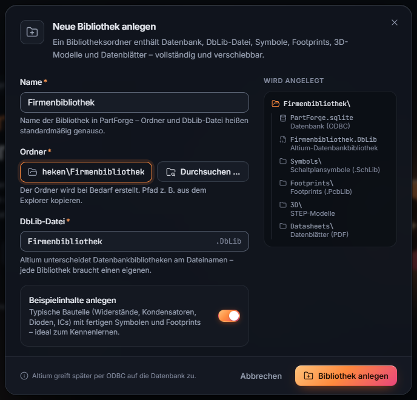

PartForge legt Datenbank, DbLib, Symbole und Footprints an und schreibt die Bibliotheksdateien. Mit
**Zur Übersicht** geht es weiter.

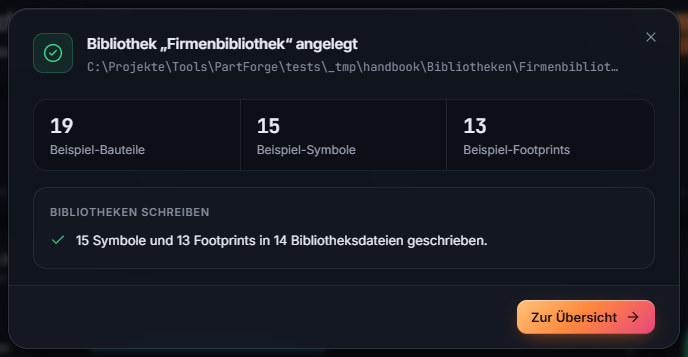

**ODBC-Treiber:** Fehlt auf Ihrem Rechner der „SQLite3 ODBC Driver“ (64 Bit), sagt Ihnen die Erfolgsmeldung das und
verlinkt den Download. Ohne ihn kann Altium die Datenbank nicht lesen.

**KI-Schlüssel (optional):** Für den Datenblatt-Import tragen Sie unter *Einstellungen › Allgemein › KI-Funktionen*
mit **Schlüssel eingeben …** einen Claude-API-Schlüssel ein und prüfen ihn mit **Verbindung testen**. Ohne Schlüssel
funktioniert alles außer der Datenblatt-Analyse und der Datenblattsuche.

Eine vorhandene Bibliothek öffnen Sie mit **Bibliothek öffnen …**. Zwischen Bibliotheken wechseln Sie oben links
über den Bibliotheks-Umschalter.

## 3. Übersicht

Die Übersicht zeigt auf einen Blick, wie es um Ihre Bibliothek steht:

- **Kennzahlen**: Bauteile, Kategorien, Symbole, Footprints und Probleme – ein Klick führt zur passenden Seite.
- **Bauteile je Kategorie** und **Letzte Änderungen** (auch gelöschte Bauteile lassen sich hier wiederherstellen).
- **Bibliotheksgesundheit**: Ergebnis der Prüfung auf fehlende Pflichtfelder, Symbole, Footprints und Datenblätter.
- **Altium und DbLib**: läuft Altium, ist die DbLib installiert und aktuell?
- Oben rechts: **Serie erzeugen** und **Datenblatt importieren**.

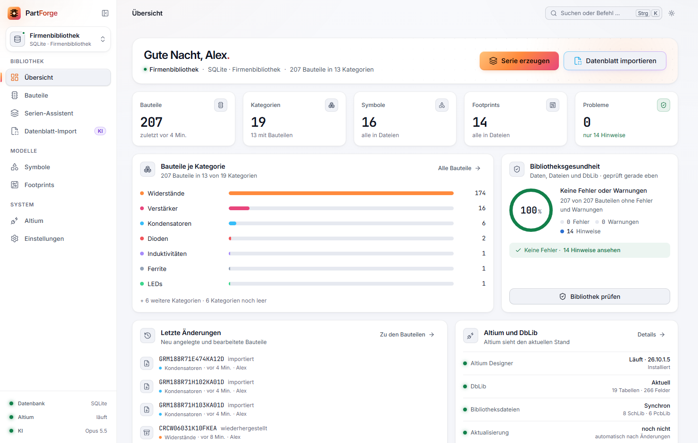

Unten links in der Seitenleiste sehen Sie immer den Zustand von Datenbank, Altium und KI.

## 4. Bauteile verwalten

### Tabelle, Suche und Filter

1. Öffnen Sie **Bauteile** und wählen Sie links eine Kategorie.
2. Tippen Sie in das Suchfeld (**Strg+F**). Sie können nach Text und nach Werten suchen: „4k7“ findet alle
   4,7-kΩ-Widerstände, „50V“ alle Bauteile mit 50 V.
3. Mit **Filter** setzen Sie Bedingungen wie „Widerstand mindestens 10k“. Häufige Filter speichern Sie unter
   **Ansichten**, die sichtbaren Spalten wählen Sie unter **Spalten**.

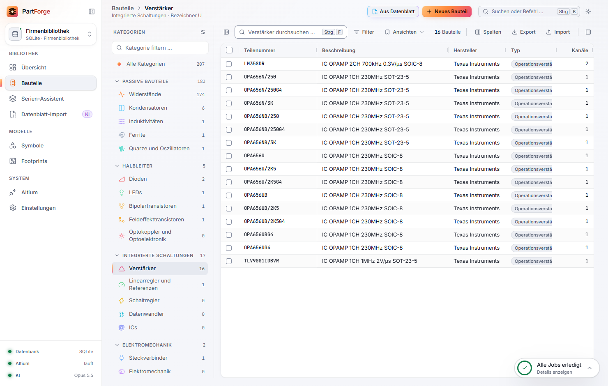

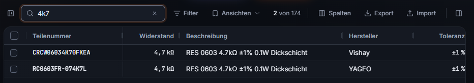

### Bearbeiten im Detailbereich

Ein Klick auf eine Zeile öffnet rechts den Detailbereich: Vorschau von Symbol, Footprint und 3D, alle Felder
(gruppiert) und unter **Verlauf** jede Änderung mit Datum und Bearbeiter. Eine Änderung wird gespeichert, sobald Sie
das Feld verlassen oder Enter drücken.
Über **Duplizieren** legen Sie eine Variante an, über das Freigabe-Menü (z. B. „Entwurf“) setzen Sie den Status.

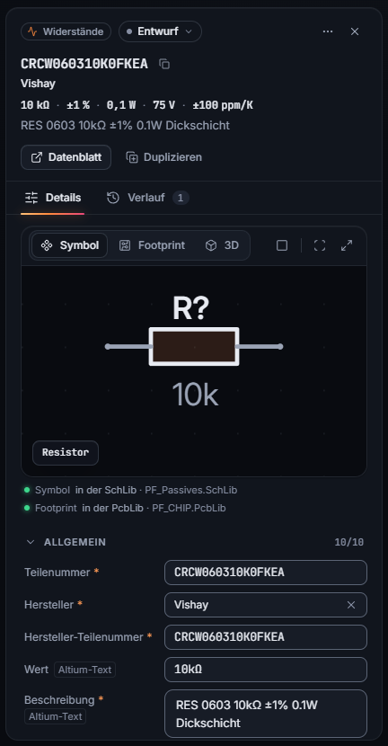

Wert, Kommentar und Beschreibung erzeugt PartForge aus den Vorlagen der Kategorie, z. B.
„RES 0603 10kΩ ±1% 0.1W Dickschicht“. Im Schaltplan sichtbar ist nur der Kommentar (z. B. „10k“).

### Neues Bauteil

1. Klicken Sie auf **Neues Bauteil** (**Strg+N**) und wählen Sie die Kategorie.
2. Tippen Sie die Werte in die **Smart-Eingabe**, z. B. `220n 50V X7R 0603 10%`. PartForge verteilt sie auf die
   Felder (markiert mit „erkannt“) und schlägt Symbol und Footprint vor.
3. Ergänzen Sie **Hersteller** und **Hersteller-Teilenummer**. Bleibt die Teilenummer leer, gilt die
   Hersteller-Teilenummer.
4. Rechts sehen Sie Symbol, Footprint und die erzeugten Texte. Steht dort „Bereit zum Anlegen“, klicken Sie auf
   **Bauteil anlegen** (**Strg+Enter**).

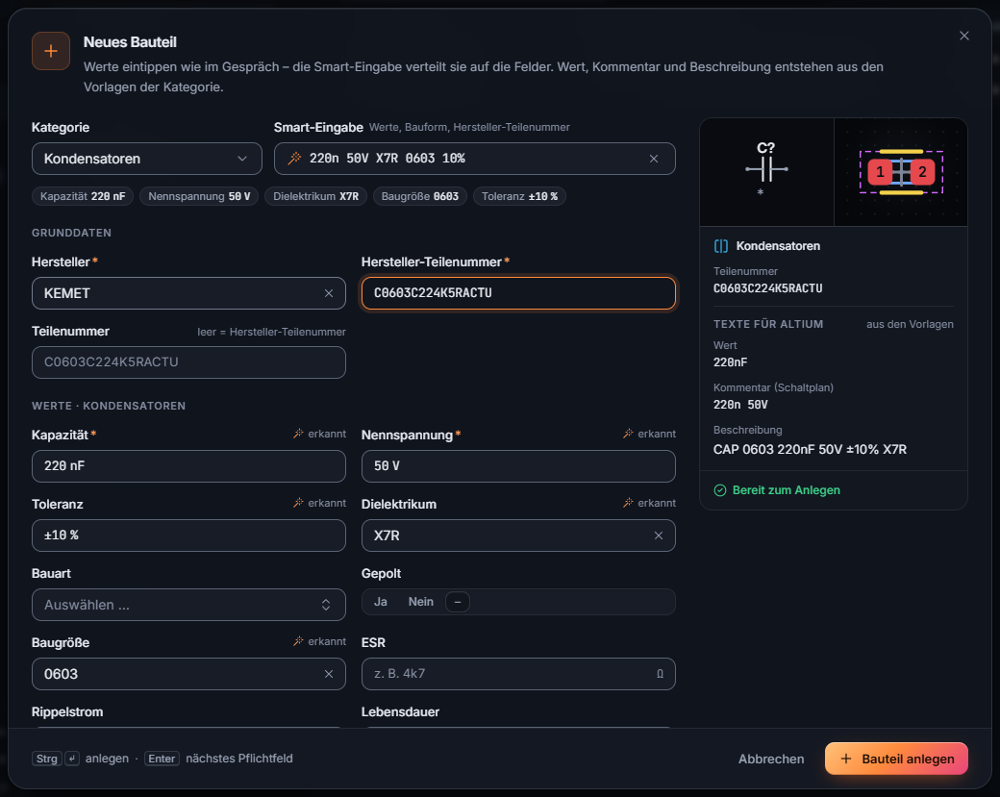

### Massenänderung

1. Haken Sie die gewünschten Zeilen an (das Kästchen im Tabellenkopf wählt alle geladenen Zeilen).
2. Klicken Sie in der Leiste unten auf **Bearbeiten**.
3. Wählen Sie ein Feld und den neuen Wert, mit **Weiteres Feld** mehrere auf einmal, und bestätigen Sie mit
   **… Bauteile ändern**.

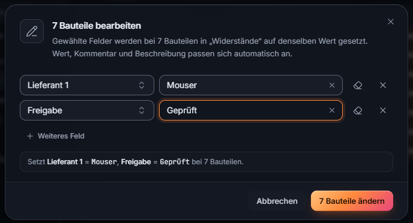

Direkt danach nimmt **Rückgängig** in der Meldung die Massenänderung zurück; Bauteile, die inzwischen erneut geändert
wurden, lässt PartForge dabei unverändert und nennt sie. Ändert eine Massenänderung mehr als 20 Bauteile, sichert
PartForge vorher außerdem automatisch die Datenbank (Kapitel 9).

### Löschen und Wiederherstellen

1. Zeilen anhaken und **Löschen** wählen (oder **Entf**), dann bestätigen.
2. Direkt danach holt **Rückgängig** in der Meldung die Bauteile mit allen Werten zurück.
3. Später geht das über *Übersicht › Letzte Änderungen*: das gelöschte Bauteil öffnen und **Wiederherstellen**
   wählen.

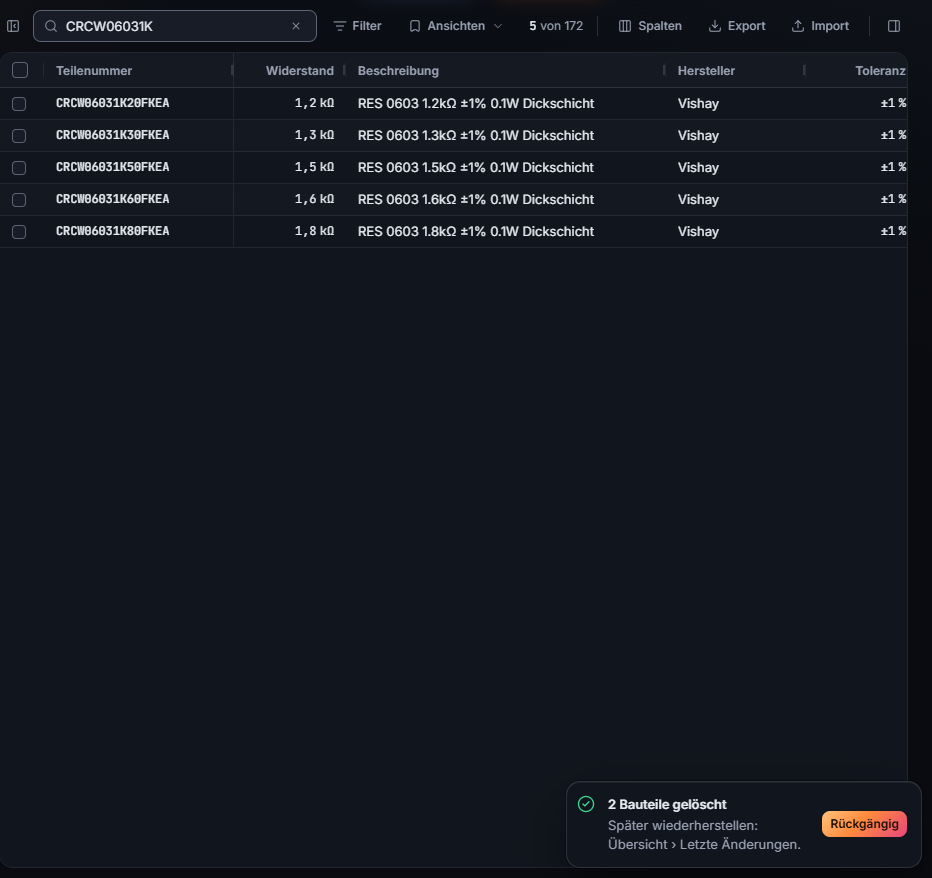

### Import und Export (CSV, Excel)

**Import:** Klicken Sie auf **Import**, ziehen Sie eine CSV-, TSV-, XLSX- oder ODS-Datei in das Fenster und folgen
Sie den Schritten *Datei → Zuordnung → Prüfen → Import*.

- PartForge ordnet die Spalten selbst den Feldern zu, Einheiten im Spaltenkopf („Kapazität (pF)“) werden beachtet.
- Fehlt eine Pflichtspalte, setzen Sie unter **Feste Werte für alle Zeilen** einen Wert für alle (z. B. das Symbol).
- Vor dem Import zeigt ein Probelauf je Zeile, was passiert („neu“, „aktualisiert“, „abgelehnt“). Sie entscheiden,
  ob vorhandene Teilenummern übersprungen oder aktualisiert werden.
- Vor dem Import legt PartForge eine Sicherung an.

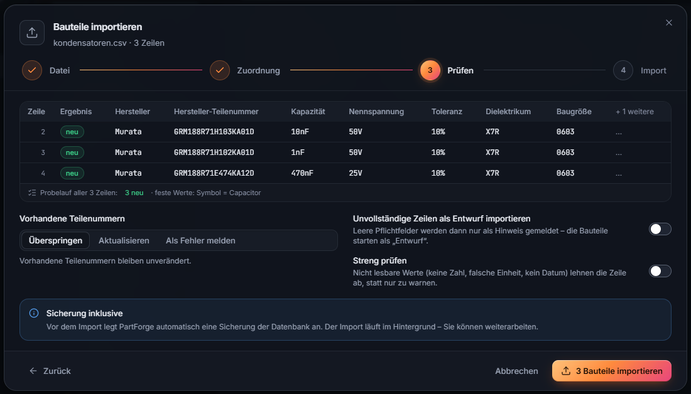

**Export:** **Export** › **Excel-Datei (XLSX)** oder **CSV-Datei** (Semikolon, UTF-8). Suche, Filter und Sortierung
der Tabelle gelten auch für den Export; mit **Nur sichtbare Spalten** exportieren Sie nur, was Sie sehen.

## 5. Widerstandsserie anlegen

Mit dem Serien-Assistenten legen Sie eine komplette Bauteilserie in einem Rutsch an – hier alle Vishay-Widerstände
CRCW in 0603, E24, von 1 Ω bis 10 MΩ, plus 0-Ω-Brücke. PartForge kennt das Teilenummern-Muster, die Codetabellen und
die lieferbaren Werte der Hersteller-Serie.

**Schritt 1 – Kategorie.** Öffnen Sie den **Serien-Assistent** und wählen Sie **Widerstände**.

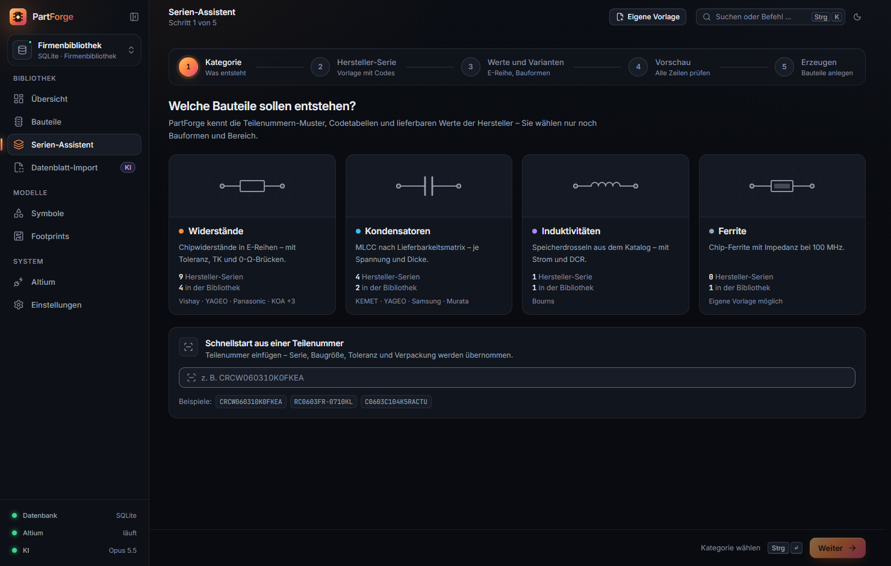

Tipp: Unter **Schnellstart aus einer Teilenummer** können Sie auch eine Teilenummer wie `CRCW060310K0FKEA`
einfügen – Serie, Baugröße, Toleranz und Verpackung werden übernommen.

**Schritt 2 – Hersteller-Serie.** Wählen Sie die Karte **VISHAY D/CRCW e3**. Jede Karte zeigt eine
Beispiel-Teilenummer mit ihren Bestandteilen und das Datenblatt, gegen das die Vorlage geprüft ist. Klicken Sie auf
**Weiter: Werte festlegen**.

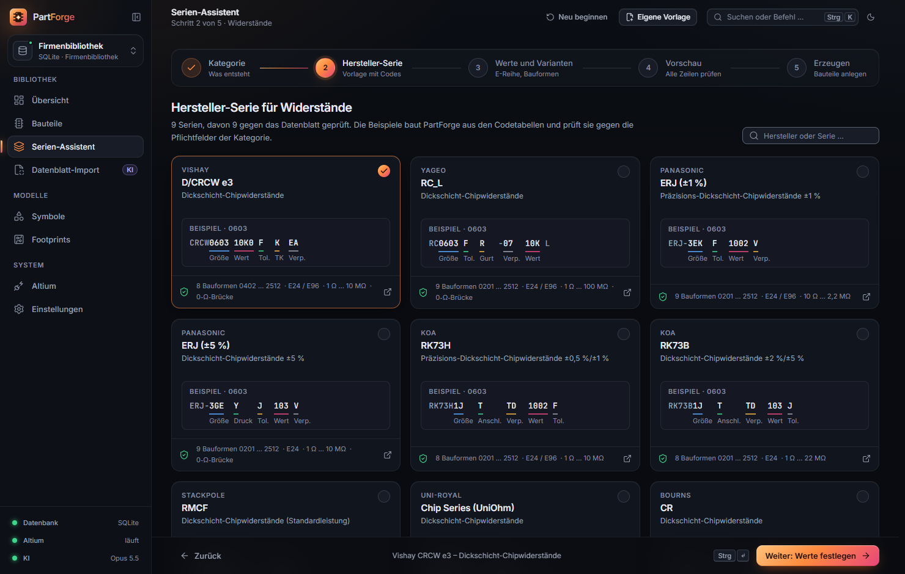

**Schritt 3 – Werte und Varianten.**

1. Unter **Bauformen** auf **Keine** klicken und dann **0603** wählen.
2. Unter **Widerstandswerte** die E-Reihe **E24** wählen. **Von**/**Bis** bleiben leer – dann gilt der ganze Bereich
   der Serie. Technische Schreibweise geht auch, z. B. `4k7` oder `1M`.
3. Unter **Varianten** die Toleranz wählen (hier ±1 %), Temperaturkoeffizient und Verpackung kommen aus dem
   Datenblatt.
4. **0-Ω-Brücken mit anlegen** einschalten, wenn Sie eine Brücke je Bauform brauchen.

Rechts rechnet der Zähler sofort mit: 1 Bauform × 169 Werte + 1 Brücke = 170 Bauteile. Darunter sehen Sie, ob
Footprints neu entstehen und welches Symbol verwendet wird. Weiter mit **Weiter: Vorschau**.

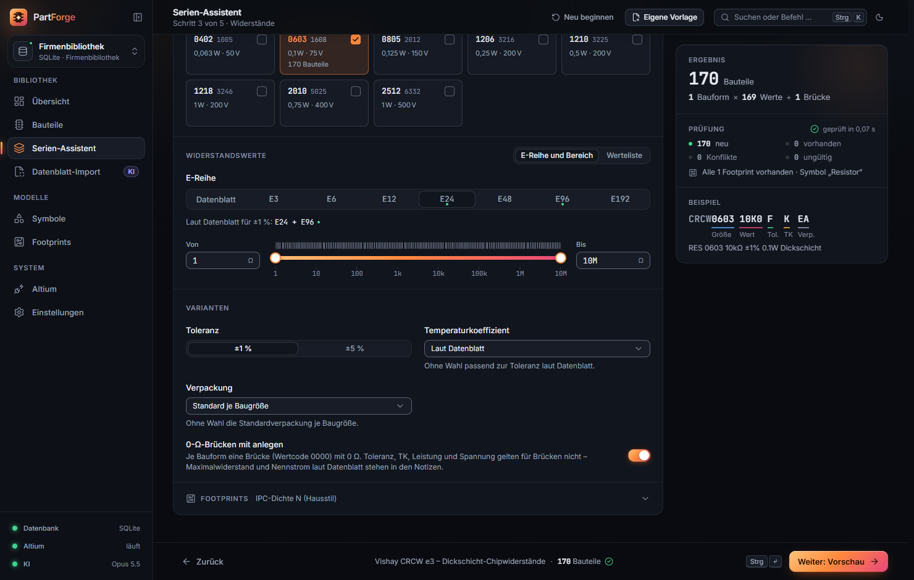

**Schritt 4 – Vorschau.** Hier stehen alle Zeilen, bevor etwas geschrieben wird – mit Status *Neu*, *Vorhanden*,
*Konflikte* oder *Ungültig*, dazu Symbol und Footprints. Weiter mit **Weiter: Erzeugen**.

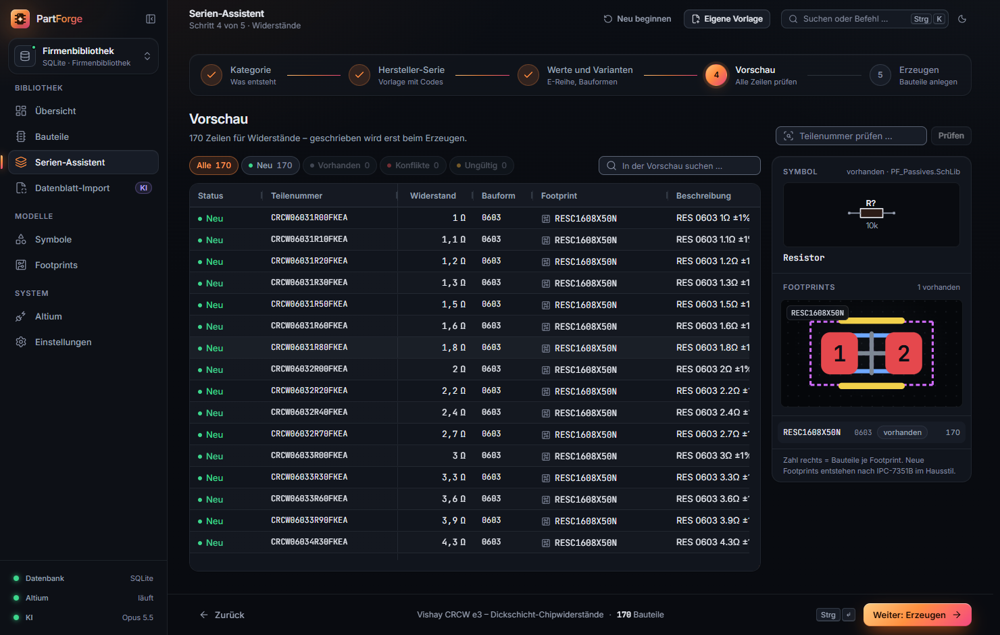

**Schritt 5 – Erzeugen.** Die Zusammenfassung nennt, was geschrieben wird. Klicken Sie auf **Serie erzeugen**
(**Strg+Enter**).

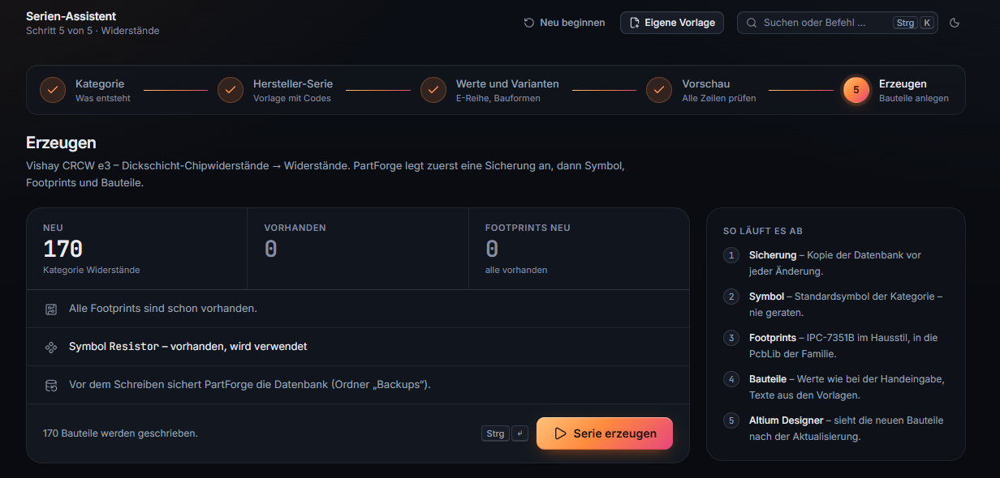

PartForge sichert zuerst die Datenbank, legt fehlende Footprints und das Symbol an und schreibt dann die Bauteile.
Läuft Altium und ist die DbLib installiert, erscheinen die neuen Bauteile dort automatisch; ist sie nicht installiert,
sagt die Erfolgsansicht das und bietet **In Altium installieren** an. Mit **In Tabelle anzeigen** sehen Sie das
Ergebnis, mit **Neue Serie** beginnen Sie die nächste.

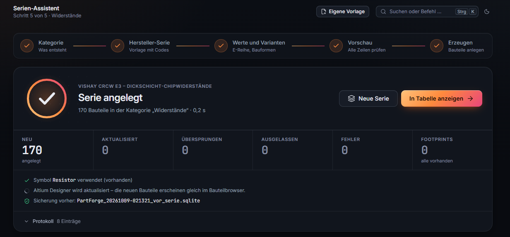

Kondensator- und Induktivitätsserien funktionieren genauso. Fehlt eine Hersteller-Serie, legen Sie sie mit
**Eigene Vorlage** selbst an.

## 6. Bauteil aus Datenblatt

Aus einem PDF-Datenblatt erzeugt PartForge mit Claude komplette Bauteile: alle Bestellvarianten, Parameter, Symbol,
Footprint und 3D-Körper. Beispiel: der Operationsverstärker OPA656 von Texas Instruments.

**1. PDF ablegen.** Ziehen Sie die PDF-Datei einfach irgendwo ins PartForge-Fenster und lassen Sie sie los. Alternativ
auf der Seite **Datenblatt-Import**: **Datei auswählen**, eine Adresse unter **Aus URL laden** eingeben oder unter
**Datenblatt suchen** die Teilenummer eingeben – dann sucht Claude das offizielle PDF im Web (höchstens 0,50 $ je
Suche).

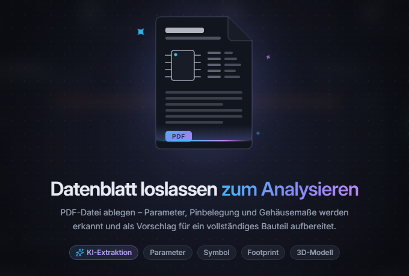

**2. KI-Analyse.** Claude liest das Datenblatt. Sie sehen die Schritte, die gelesenen Seiten, was schon erkannt
wurde, die Laufzeit und die **Kosten bisher** mit dem Kostenlimit (Standard 2,00 $ je Import). Eine typische Analyse
dauert etwa eine halbe Minute und kostet ein paar Cent bis rund 0,25 $. Mit **Abbrechen** stoppen Sie sie; bezahlte
Anfragen bleiben gespeichert.

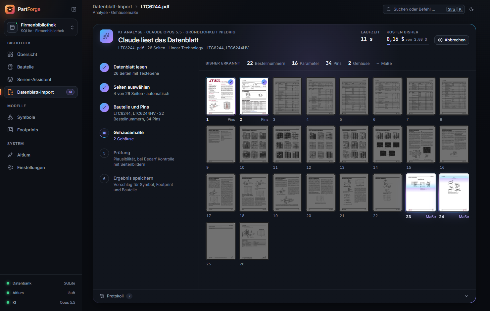

**3. Prüfen.** Die Prüfansicht hat drei Spalten: links die PDF-Seiten, in der Mitte die erkannten Daten
(**Identität**, **Varianten**, **Parameter**, **Pins**, **Gehäuse**, **Hinweise**), rechts die Vorschau von Symbol,
Footprint und 3D.

- Jede Angabe hat ihre Fundstelle (z. B. „S. 2“) – ein Klick zeigt die Seite groß.
- Unter **Varianten** wählen Sie die Bestellnummern, die angelegt werden sollen.
- Unter **Pins** und **Gehäuse** kontrollieren Sie Pinbelegung und Maße. Werte korrigieren Sie per Klick;
  **Strg+Z** nimmt die letzte Korrektur zurück.
- Für den Footprint wählen Sie **IPC-7351B** (berechnet), **Hersteller** (Land Pattern aus dem Datenblatt) oder
  **Vorhanden** (ein Footprint aus Ihrer Bibliothek).

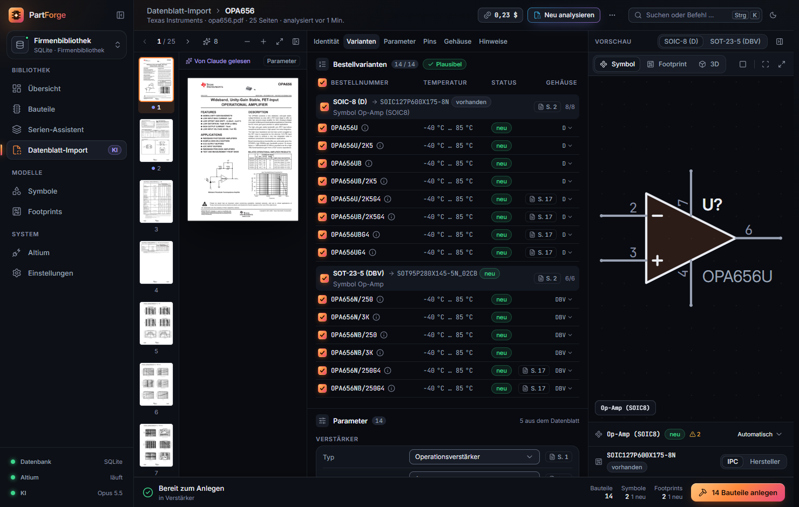

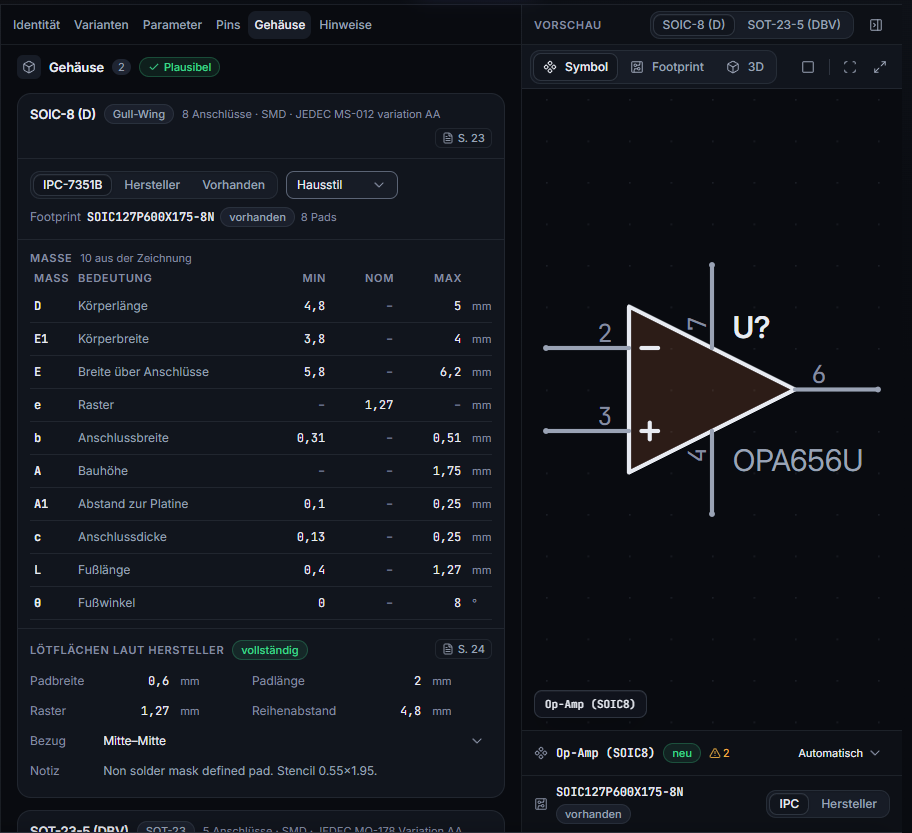

Meldet PartForge Probleme (z. B. Pins ohne Pad), müssen Sie jedes bestätigen, bevor angelegt werden kann.

**4. Bauteile anlegen.** Steht unten „Bereit zum Anlegen“, klicken Sie auf **… Bauteile anlegen** (**Strg+Enter**).
PartForge schreibt Symbol und Footprint in die Bibliotheksdateien und legt die Bauteile an – mit Link zum
Datenblatt.

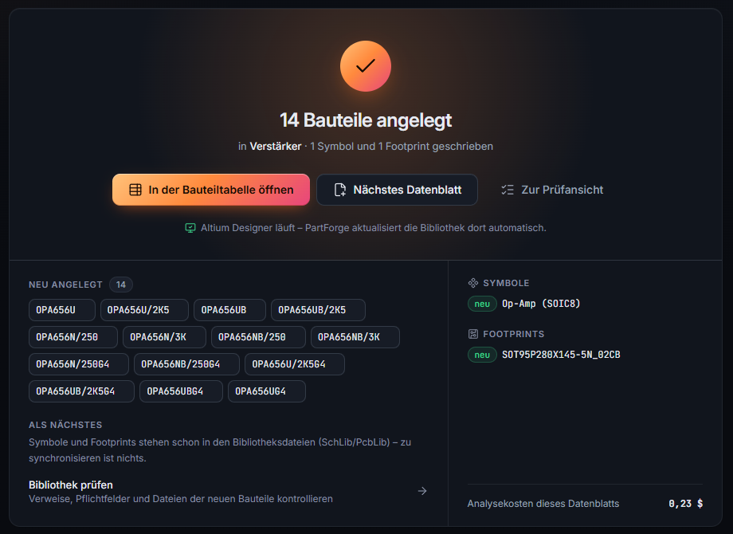

**Kosten:** Der Betrag oben in der Kopfzeile (z. B. „0,23 $“) zeigt die Kosten der Analyse, aufgeteilt nach
Anfragen. **Neu analysieren** zeigt vor dem Start die erwarteten Kosten und lässt Sie Seiten, Modell,
Gründlichkeit und Kostenlimit wählen.

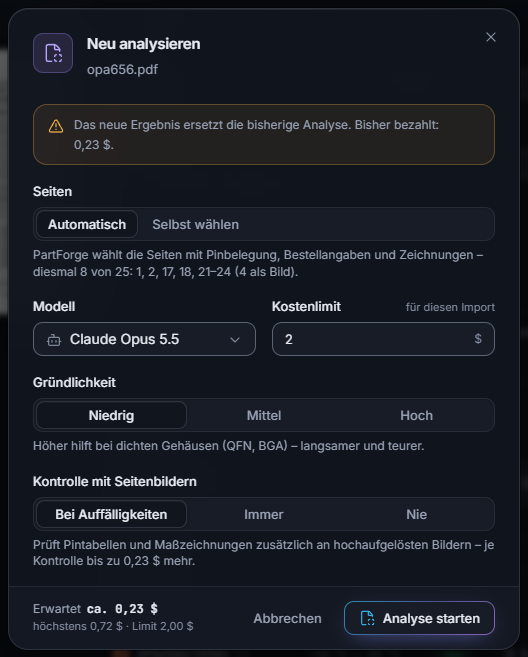

**Ohne KI-Schlüssel:** Das PDF wird trotzdem gespeichert und erscheint unter *Bisherige Datenblätter* als
„Noch nicht analysiert“. Ein Knopf führt zu den Einstellungen, um den Claude-API-Schlüssel zu hinterlegen; danach
starten Sie die Analyse mit **Mit Claude analysieren**. Datenblätter verlassen Ihren Rechner nur bei dieser Analyse.

## 7. Symbole und Footprints

**Symbole** (Seite *Symbole*): Unter **Generator** wählen Sie links einen von 40 Standardtypen (Widerstand, Diode,
OPV, Steckverbinder …) oder **IC (Pinliste)**. Für ICs geben Sie die Pins ein oder fügen sie mit **Einfügen …** aus
einer Tabelle ein; PartForge ordnet sie automatisch an (Versorgung oben links, Masse unten, Eingänge links, Ausgänge
rechts). Mit **In Bibliothek speichern** (**Strg+S**) landet das Symbol in der SchLib. Unter **Bibliothek** sehen Sie
alle Symbole mit ihrer Verwendung.

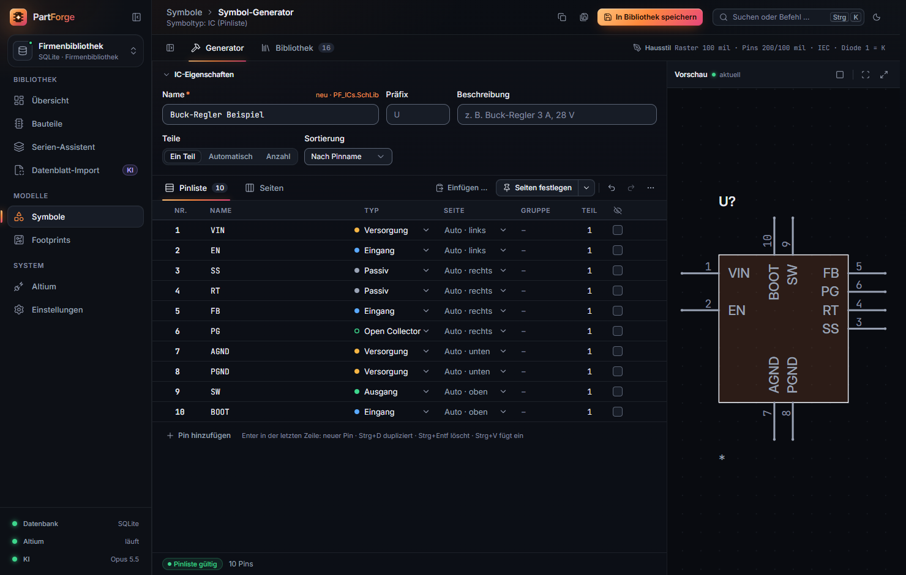

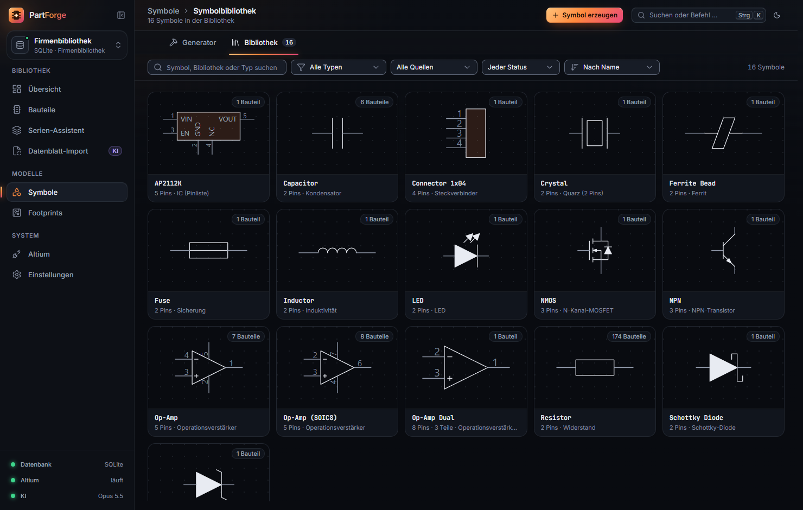

**Footprints** (Seite *Footprints*): Gehäusefamilie wählen (21 Familien, 189 Vorlagen – von 0402 über SOT-23 bis
QFN und BGA), Vorlage anklicken, bei Bedarf Maße (min/nom/max) aus dem Datenblatt eintragen und die Dichte wählen
(**Klein (L)**, **Nominal (N)**, **Groß (M)**). PartForge rechnet nach IPC-7351B und zeigt Lötflächen, Courtyard und
den IPC-Namen. Eine Herstellerempfehlung ersetzt auf Wunsch die Berechnung. **In Bibliothek speichern** schreibt in
die PcbLib, **STEP herunterladen** liefert das 3D-Modell.

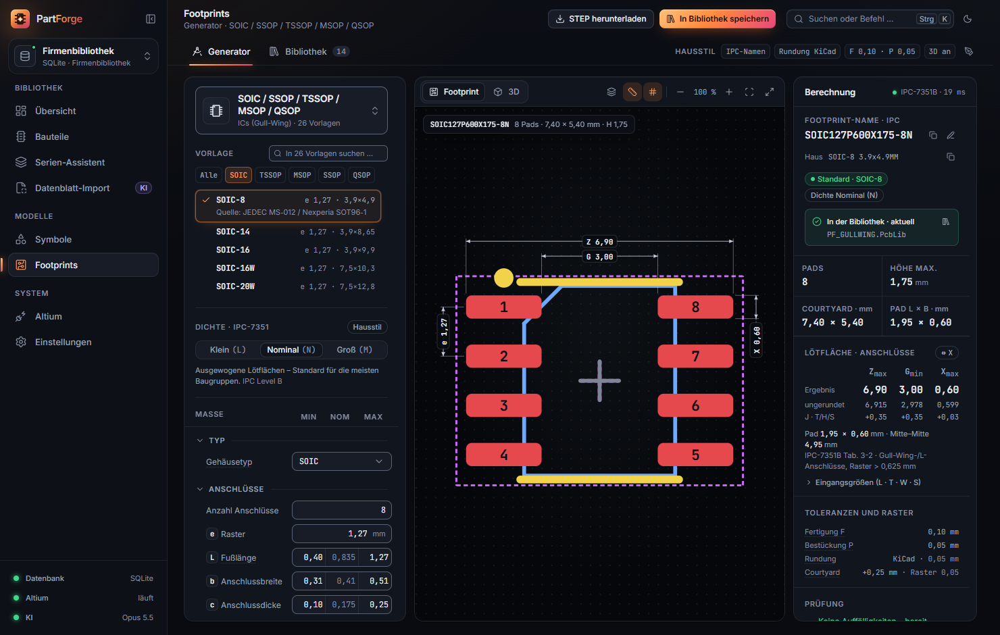

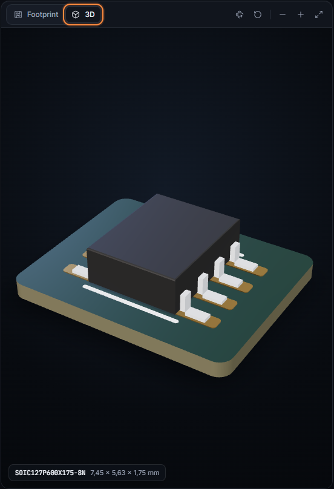

**Hausstil:** Linienbreiten, Pin-1-Markierung, Namensschema, Symbolfarben und die Zuordnung der mechanischen Lagen
stellen Sie einmal unter *Einstellungen › Hausstil* ein (Reiter Footprints, Lagen, Symbole). Alle neuen Symbole und
Footprints folgen ihm.

## 8. Altium

Die Seite **Altium** zeigt die Kette Bauteile → DbLib → Bibliotheksdateien → Altium Designer und was zu tun ist.

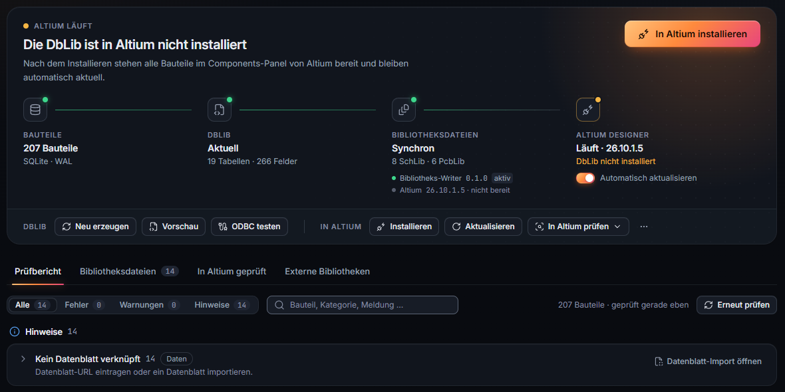

**Installieren:** Klicken Sie auf **In Altium installieren**. Danach steht die Bibliothek im Components-Panel von
Altium.

**Automatisch aktualisieren:** Ist der Schalter an, sieht ein laufendes Altium jede Änderung aus PartForge nach
wenigen Sekunden. Von Hand geht es mit **Aktualisieren**.

**Prüfen:**

- Der **Prüfbericht** findet fehlende Pflichtfelder, Symbole, Footprints, Datenblätter und doppelte Teilenummern –
  meist mit direktem Weg zur Lösung.
- **In Altium prüfen** lässt Altium jedes Bauteil auflösen, genau wie beim Platzieren (Stichprobe, alle Bauteile oder
  eine Kategorie). Im Reiter **In Altium geprüft** sehen Sie je Bauteil Symbol, Pins, Footprints sowie Comment und
  Beschreibung. Ein Klick auf „… Parameter“ vergleicht alle Parameter in Altium mit der Datenbank.

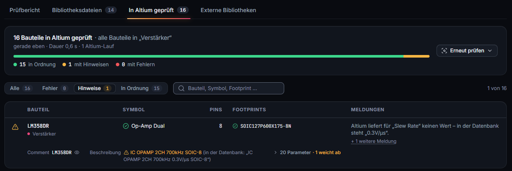

**DbLib:** **Neu erzeugen** schreibt die DbLib neu, **Vorschau** zeigt ihren Inhalt, **ODBC testen** liest die
Datenbank so wie Altium.

**Deinstallieren:** Mit **Deinstallieren** entfernen Sie die DbLib aus Altium. Altium hält die Datenbank danach noch
eine Weile offen (meist etwa eine Minute); erst dann lässt sich der Ordner verschieben.

**Bauteil in Altium platzieren:** In Altium das Panel *Components* öffnen, oben die DbLib Ihrer Bibliothek wählen
(z. B. `Firmenbibliothek.DbLib`), Kategorie wählen, Bauteil suchen und in den Schaltplan ziehen. Symbol, Footprint,
3D-Modell und Parameter kommen aus der Bibliothek.

## 9. Einstellungen und Sicherungen

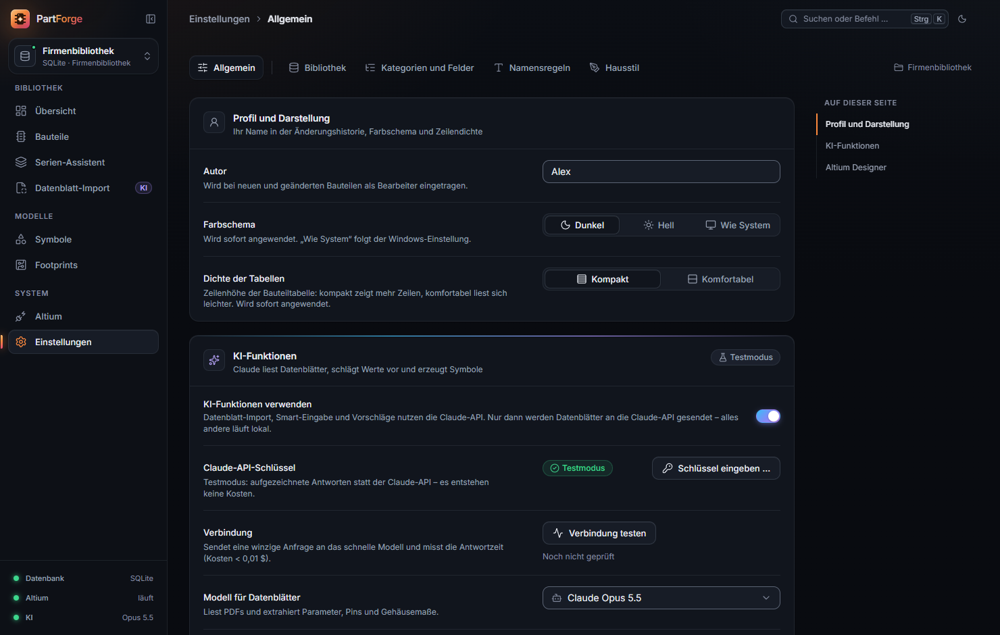

- **Allgemein:** Autor (steht im Verlauf), Farbschema (Dunkel, Hell, Wie System), Tabellendichte; **KI-Funktionen**
  (Schlüssel, Modell, Gründlichkeit, Kostenlimit je Import); **Altium Designer** (Pfad zu X2.EXE,
  Bibliotheks-Writer, automatisch aktualisieren).
- **Bibliothek:** Name, DbLib-Datei, Teilenummern-Schema (Hersteller-Teilenummer oder eigene Nummern), Speicherort
  und **Sicherungen**.
- **Kategorien und Felder:** eigene Kategorien und Felder, Text-Vorlagen für Wert, Kommentar und Beschreibung.
- **Namensregeln** und **Hausstil** (Footprints, Lagen, Symbole).

**Sicherungen:** PartForge sichert die Datenbank automatisch vor jeder riskanten Aktion (Serie, Import, Löschen oder
Massenänderung vieler Bauteile, Kategorie oder Feld löschen, Wiederherstellen). Unter
*Einstellungen › Bibliothek › Sicherungen* legen Sie mit **Jetzt sichern** selbst eine an und holen mit
**Wiederherstellen …** einen früheren Stand zurück. Der Stand vor dem Wiederherstellen wird dabei ebenfalls gesichert.

## 10. Befehlspalette und Tastenkürzel

Mit **Strg+K** (oder dem Suchfeld oben) öffnen Sie die Befehlspalette: Seiten, Aktionen und eine Live-Suche über alle
Bauteile.

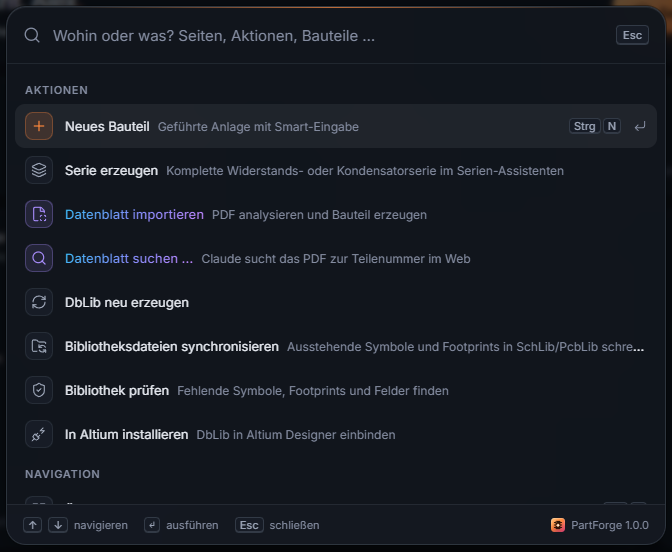

| Kürzel | Wirkung |
| --- | --- |
| Strg+K | Befehlspalette |
| Alt+1 … Alt+8 | Übersicht, Bauteile, Serien-Assistent, Datenblatt-Import, Symbole, Footprints, Altium, Einstellungen |
| Strg+N | Neues Bauteil |
| Strg+B | Seitenleiste ein-/ausklappen |
| Strg+F | Suche in der Bauteiltabelle (im Footprint-Generator: Gehäusefamilie suchen) |
| Strg+Enter | Anlegen bzw. weiter: neues Bauteil, Serien-Assistent, Datenblatt-Import |
| Strg+S / Strg+Umschalt+S | Speichern / Speichern unter (Symbol, Footprint, Einstellungen) |
| Strg+Z / Strg+Y | Rückgängig / Wiederholen (Footprint-Generator, IC-Editor); Strg+Z nimmt auch die letzte Korrektur im Datenblatt-Import zurück |
| Enter | in der Tabelle: Details zum Bauteil öffnen |
| Entf | gewählte Bauteile löschen (mit Bestätigung) |
| Strg+A | alle geladenen Zeilen der Tabelle wählen |
| F6 / Umschalt+F6 | zwischen Suche, Tabelle und Details wechseln |
| Alt+← / Alt+→ | im Serien-Assistenten zurück / vor |
| Esc | Dialog oder Menü schließen |

In der IC-Pinliste: **Strg+D** dupliziert einen Pin, **Strg+Entf** löscht ihn, **Strg+Umschalt+O** setzt den
Überstrich (low-aktiv).

## 11. Häufige Fragen und Fehlerbehebung

**Neue Bauteile fehlen in Altium.** Seite *Altium* → **Aktualisieren**; prüfen, dass die DbLib installiert ist.

**Altium liest keine Bauteile.** Den „SQLite3 ODBC Driver“ (64 Bit) installieren, dann auf der Seite *Altium*
**ODBC testen**.

**Altium reagiert nicht auf PartForge.** In Altium hängt vermutlich ein Skript: in Altium **Strg+F3** drücken.

**„database is locked“.** Die Bibliothek liegt auf einem Netzlaufwerk – den Bibliotheksordner auf ein lokales
Laufwerk legen.

**SchLib/PcbLib werden nicht geschrieben.** *Einstellungen › Allgemein › Altium Designer*: Pfad zum
Bibliotheks-Writer (`altium-designer-mcp.exe`) prüfen. Die Bibliothek darf in Altium keine ungespeicherten
Änderungen haben.

**Datenblatt-Import nicht möglich.** *Einstellungen › Allgemein › KI-Funktionen*: Schlüssel eintragen und
**Verbindung testen**.

**Ordner lässt sich nach dem Deinstallieren nicht verschieben.** Altium hält die Datenbank noch offen – etwa eine
Minute warten, sonst Altium beenden. Vorher in PartForge die Bibliothek schließen.

**Etwas falsch geändert?** Gelöschte Bauteile: *Übersicht › Letzte Änderungen* → **Wiederherstellen**. Eine
Massenänderung: direkt danach **Rückgängig** in der Meldung. Alles andere: *Einstellungen › Bibliothek › Sicherungen*.

Weitere Hinweise zu Installation, Datenablage und Deinstallation stehen im [Handbuch zum Programmpaket](README.md).
